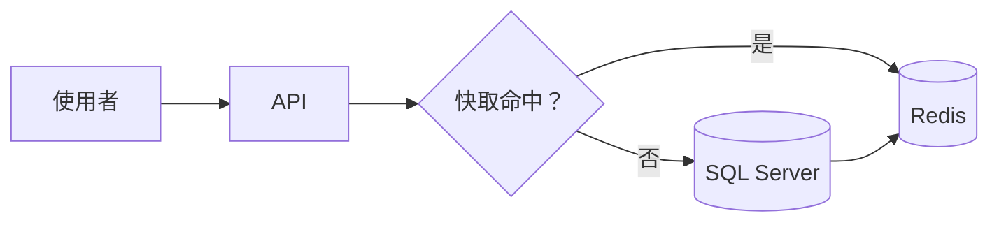
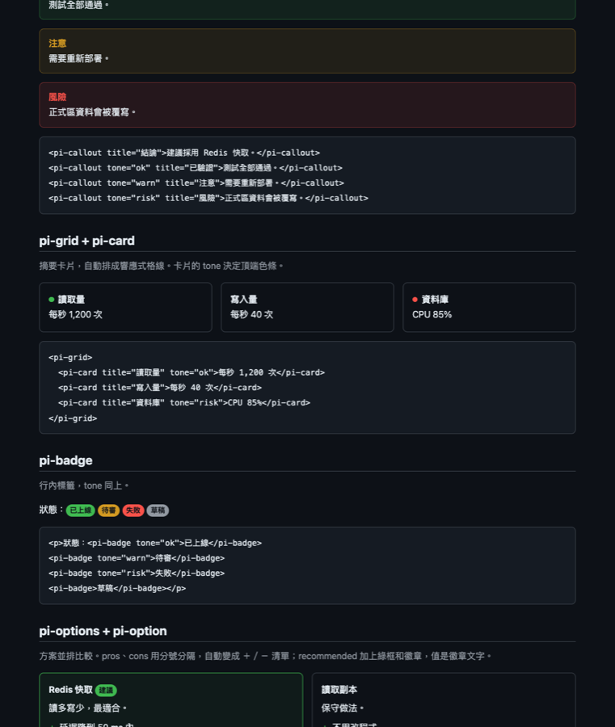

# 快取策略選擇

這頁是純 Markdown，由 `show_doc` 以 `view: "page"` 渲染。選取任何一段文字，可以針對它留言給 agent。

> [!WARNING] 現況
> API p95 延遲 820 ms，超過 SLO 的 500 ms。

> [!TIP]
> 九成讀取集中在同一批商品資料。

## 現況

```cards
- title: 讀取量
  tone: ok
  body: 每秒 **1,200** 次
- title: 寫入量
  body: 每秒 40 次
- title: 資料庫
  tone: risk
  body: CPU 85%，接近上限
```

## 資料流



## 方案比較

```options
- title: Redis 快取
  recommended: 建議
  body: 讀多寫少，最適合。
  pros: [延遲降到 50 ms 內, 已有 Redis 叢集]
  cons: [要處理失效]
- title: 資料庫讀取副本
  body: 保守做法。
  pros: [不用改程式]
  cons: [成本加倍, 延遲只降一半]
```

| 項目 | Redis | 副本 |
| --- | --- | --- |
| 月成本 | $40 | $300 |
| 上線時間 | 2 天 | 1 週 |

## 要改的程式

```diff
@@ ProductService.cs @@
-var product = await db.Products.FindAsync(id);
+var product = await cache.GetOrSetAsync($"product:{id}", () => db.Products.FindAsync(id));
```

## 參考畫面



## 請決定

```form
title: 快取方案
submit: 送給 agent
questions:
  - name: strategy
    label: 採用哪個方案？
    required: true
    choices:
      - {value: redis, label: Redis 快取, recommended: 建議, note: 兩天可上線}
      - {value: replica, label: 資料庫讀取副本}
  - name: scope
    label: 先套用到哪些 API？
    type: multi
    other: 其他
    choices: [訂單, 商品]
  - name: notes
    label: 補充
    hint: 可留空
```
